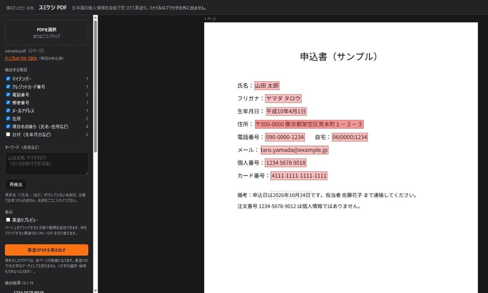
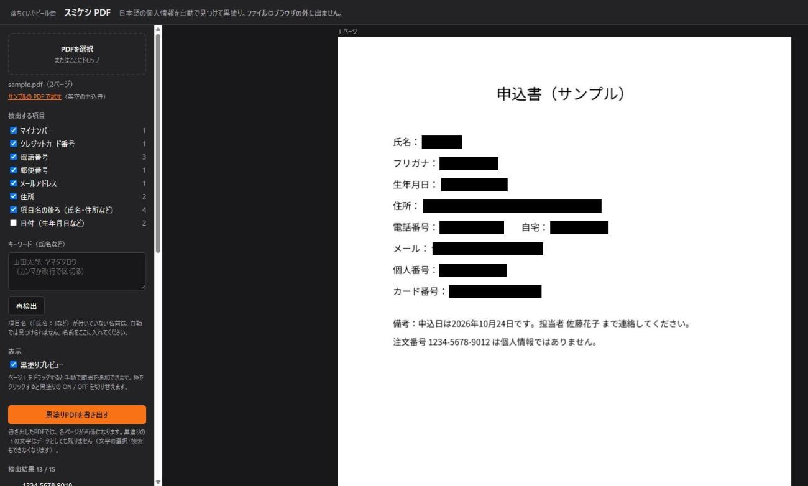

# スミケシ PDF

PDF の中の日本語の個人情報を自動で見つけて黒塗りする Web ツールです。
**ファイルはサーバーに送らず、すべてブラウザの中で処理します。**

- 使ってみる：https://falledcan.net/sumikeshi/
- 紹介記事：https://falledcan.net/blog/posts/sumikeshi-pdf-redaction-tool



## できること

- PDF を読み込むだけで、次のものを自動で見つけて印を付ける
  - 氏名・フリガナ・住所・生年月日など（「氏名：」「住所：」のような項目名の後ろ）
  - 住所（都道府県名から始まるもの）
  - 電話番号・郵便番号・メールアドレス
  - マイナンバー・クレジットカード番号（チェックデジットが合うものだけ）
  - 日付（初めは OFF）
- 項目名の付いていない名前は、キーワードで追加
- ページの上をドラッグして、手で範囲を追加（スキャンした PDF にも）
- 見つけたものを 1 つずつ ON / OFF
- 黒塗りプレビュー
- 黒塗りした PDF を書き出す



## 黒塗りの下の文字は残りません

書き出すときに、**各ページを画像にしてから黒く塗ります**。元の文字のデータは書き出したファイルに入らないので、コピーや検索で文字を取り出すことはできません。元のファイルの作成者などの情報も引き継ぎません。

そのかわり、書き出した PDF では文字の選択・検索ができなくなり、ファイルも少し大きくなります。

## 動かし方

ビルドは要りません。静的なファイル（`index.html`・`app.js`・`style.css`）だけで動きます。
ブラウザが PDF の部品を読み込むため、ファイルを直接開くのではなく、簡単な Web サーバーで開いてください。

```
python -m http.server 8765
```

ブラウザで http://localhost:8765/ を開き、「サンプルの PDF で試す」を押すと、架空の申込書（`samples/sample.pdf`）で試せます。

## 使っているもの

- [pdf.js](https://github.com/mozilla/pdf.js)（PDF の表示と文字の取り出し、Apache License 2.0）
- [pdf-lib](https://github.com/Hopding/pdf-lib)（PDF の書き出し、MIT License）

どちらも cdnjs から読み込みます。読み込んだ PDF をどこかへ送る処理はありません。

## 気をつけること

- 自動の検出は見落とすことがあります。書き出す前に、必ず全ページを目で確かめてください
- 項目名の付いていない名前は、自動では見つけられません（キーワードに入れてください）
- スキャンした画像の PDF は文字のデータが無いので、手で囲ってください
- 斜めに書かれた文字は、枠が少しずれることがあります

`samples/sample.pdf` の名前・住所・電話番号・番号は、すべて架空のものです。
